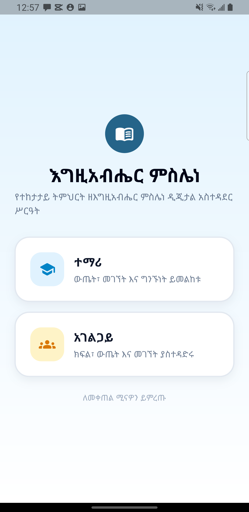
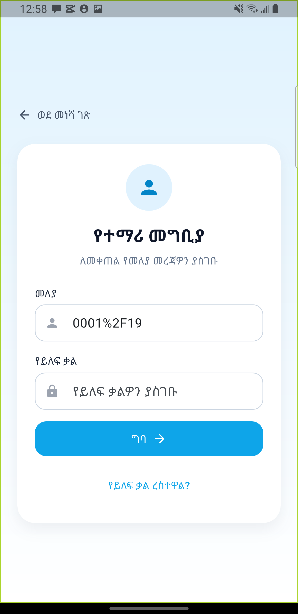
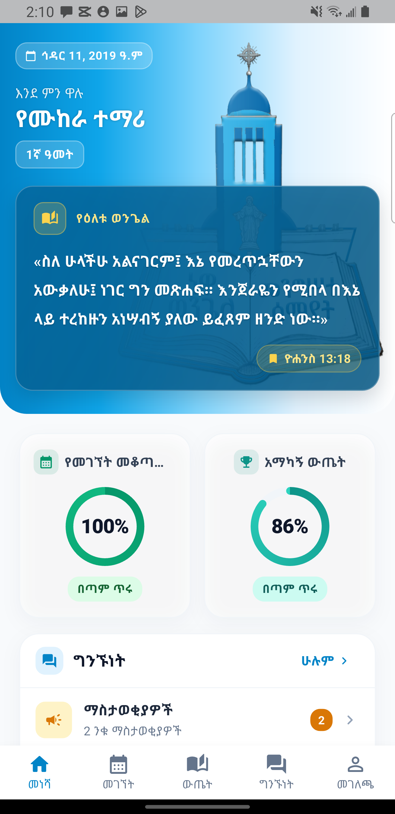
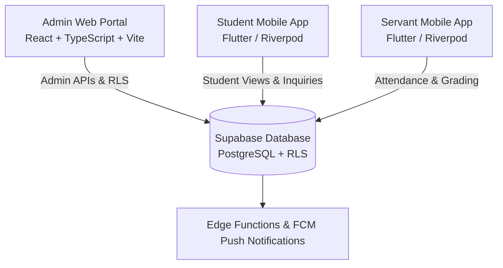

# ተከታታይ ትምህርት ዘእግዚአብሔር ምስሌነ
### Sunday School Management System (ERP)

A unified church education management platform featuring a **Web Admin Portal** (React/TypeScript) and a **Cross-Platform Mobile App** (Flutter) powered by **Supabase**. The system streamlines curriculum management, attendance tracking, assessment scoring, annual promotions, and communication between administrators, servants (teachers), and students.

---

## 📸 Application Preview

<p align="center">
  
  &nbsp;&nbsp;&nbsp;&nbsp;
  
  &nbsp;&nbsp;&nbsp;&nbsp;
  
</p>

<p align="center">
  <em>Role Selection &bull; Student Sign-In &bull; Student Dashboard with 365-Day Daily Gospel Verse</em>
</p>

---

## 🏛️ System Architecture



| Component | Technology | Primary Audience | Deployment |
|---|---|---|---|
| **Admin Web Portal** (`admin-panel/`) | React 18, TypeScript, Tailwind CSS, Vite | School Administration (ንዑስ ክፍል) | Vercel |
| **Mobile App** (`sunday_school_app/`) | Flutter 3.x, Riverpod, Material 3 | Students & Servants (Teachers) | Android (APK) & iOS |
| **Backend & Cloud** (`supabase/`) | PostgreSQL, Row Level Security, Edge Functions | System-wide | Supabase Cloud |

---

## 🌐 The Web Admin Portal (`admin-panel/`)

The **Admin Portal** is the central command center for Sunday school directors and department sub-committees (ንዑስ ክፍል). Built with React and TypeScript, it ensures institutional integrity by enforcing strict role-based operational permissions.

### Core Modules & Features:

1. **Academic Year & Semester Lifecycle**
   - Manage academic years synchronized with the Ethiopian Calendar (`ዓ.ም`).
   - Track semester transitions (**Semester 1** &rarr; **Semester 2** &rarr; **Year-End**).
   - Safe archiving of completed school years with historical preservation.

2. **Curriculum & Course Management (Admin-Exclusive)**
   - Creation and assignment of courses/subjects per grade level are strictly reserved for administrators.
   - Prevents unauthorized course modifications or grade-level discrepancies by teaching staff.

3. **User Management & Academic ID Allocation**
   - Automated sequential academic ID generator (`0001/yy`, `0002/yy`, etc.).
   - Onboarding and credential generation for servants and students.
   - Account status toggling (active, suspended, alumni) and one-click password resets.

4. **Automated Promotion Engine**
   - Custom threshold configuration per grade: Minimum Passing Score (e.g., 70%) and Attendance Requirement (e.g., 75%).
   - Automated classification: `eligible` (promoted), `not_eligible` (retained), or `at_risk`.
   - Batch promotion execution with graduate roster archiving.

5. **Complaints & Academic Appeals Center**
   - Review and resolve student-submitted complaints regarding assessment marks or attendance records.
   - Transparent auditing: responses and adjustments are immediately reflected in the student's mobile dashboard.

6. **Broadcast & Announcement Center**
   - Publish targeted notices (school-wide or grade-specific).
   - Real-time mobile push notifications dispatched via Firebase Cloud Messaging (FCM).

---

## 📱 The Mobile App (`sunday_school_app/`)

A cross-platform Flutter application tailored with dedicated user experiences for both **Students** and **Servants**.

### 1. Student Experience (የተማሪ መተግበሪያ)
- **Celestial Dashboard Header**: Continuous sky-to-white gradient framing the church emblem, tailored for high legibility and contrast.
- **365-Day Daily Gospel Verse ("የዕለቱ ወንጌል")**:
  - Rotating bilingual catalogue (Matthew, Mark, Luke, John) with 365 unique daily readings.
  - Automatically advances at midnight without repeating for a full year; runs 100% offline.
  - Formatted in Ge'ez typography (`«` `»`) with canonical reference chips (e.g., `ዮሐንስ 13:18`).
- **Academic & Attendance Gauges**: Real-time attendance percentage ring and average grade metrics.
- **Subject-by-Subject Breakdown**: View quiz, exam, and assignment scores.
- **Support & Complaints**: In-app form to file inquiries or dispute marks directly to school administrators.

### 2. Servant / Teacher Experience (የአገልጋይ መተግበሪያ)
- **Fast Attendance Taker**: One-tap Sunday attendance recording with offline-sync support.
- **Assessment Scoring**: Streamlined grade entry with natural-key idempotency to prevent duplicate entries.
- **Class Roster & Student Profiles**: Real-time visibility into students' attendance records and performance status.
- **Direct Student Q&A**: Reply directly to theological or subject-matter questions submitted by students.

---

## 🚀 Getting Started

### Prerequisites
- **Node.js** (v18+) & `npm`
- **Flutter SDK** (v3.29+ / Dart 3.7+)
- **Android Studio** / Xcode / `adb` (for mobile deployment)
- **Supabase CLI** (optional, for local database development)

---

### Running the Web Admin Portal

```bash
cd admin-panel

# Install dependencies
npm install

# Configure environment variables
cp .env.example .env
# Set VITE_SUPABASE_URL and VITE_SUPABASE_ANON_KEY

# Start Vite dev server
npm run dev
```

Visit `http://localhost:5173` to access the admin portal.

---

### Running the Flutter Mobile App

```bash
cd sunday_school_app

# Fetch dependencies
flutter pub get

# Run static code analysis
flutter analyze

# Run unit and widget tests
flutter test

# Run on connected device or emulator
flutter run

# Build production Android release APK
flutter build apk --release
```

---

## 🗄️ Database & Security

- **Row Level Security (RLS)**: Enforced across all Supabase tables (`profiles`, `grades`, `subjects`, `assessments`, `scores`, `attendance_sessions`, `attendance_records`, `announcements`, `complaints`).
- **Role Verification**: High-privilege operations verify role membership (`admin`, `servant`, `student`) server-side via PostgreSQL RPCs and Edge Functions.
- **Data Integrity**: Enforced unique natural keys across assessment scores (`(assessment_id, student_id)`) and attendance sessions (`(academic_year_id, grade_id, session_date)`).

---

## 📄 License & Attribution

Developed for **ተከታታይ ትምህርት ዘእግዚአብሔር ምስሌነ**. All rights reserved.
